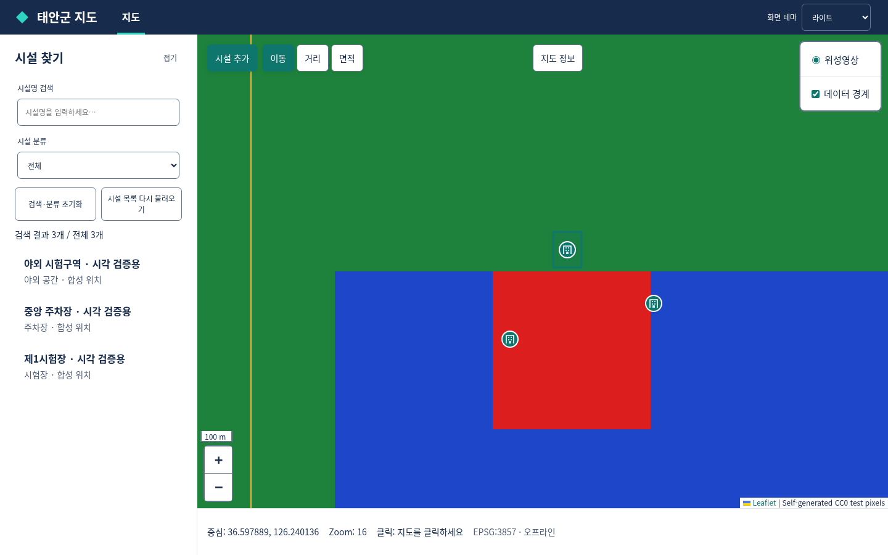
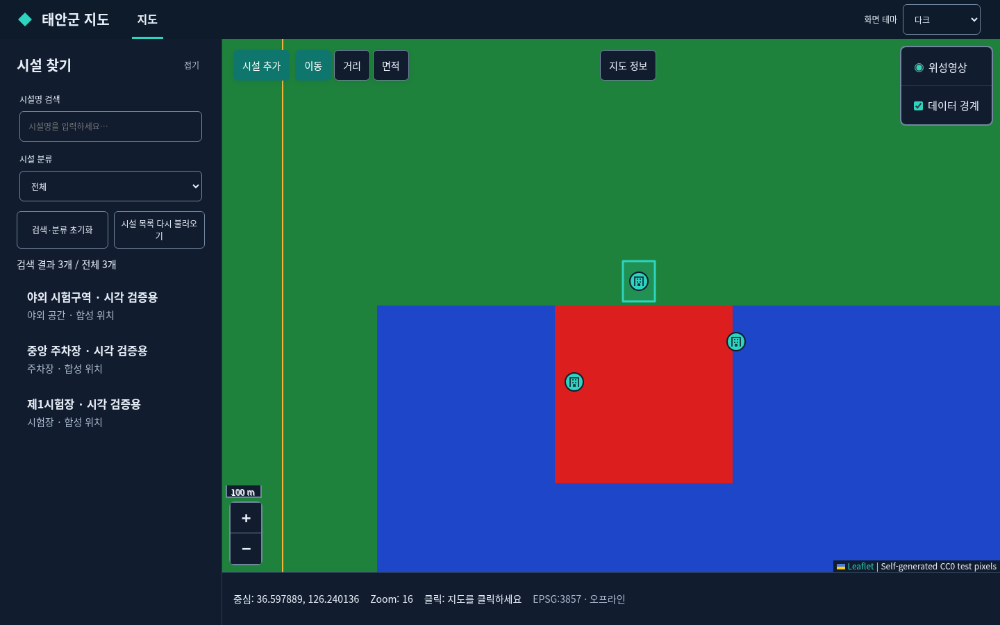
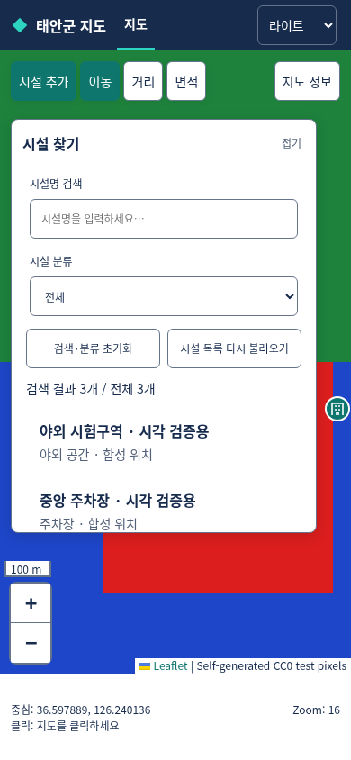
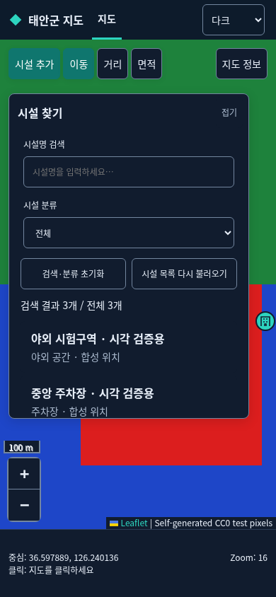

# 이슈 #13 지도 전체 화면 디자인 검토

2026-11-21–22(KST). 변경 전 기준 main `1cf49525be87cde44b1f119708d6818f6ad5c69d`. 이슈 #11의 경계 기능과 부분 토큰 적용을 유지하면서 화면 전체를 별도로 재구성했다. 기존 API·UUID·boundary 스키마·파일 저장·공통 디자인 기준/lock·타 모듈·상위 gitlink는 변경하지 않는다.

## 기준과 촬영 조건

[platform-ui-design](../.agents/skills/platform-ui-design/SKILL.md), [MASTER](../design-system/platform/MASTER.md), [IMPLEMENTATION](../design-system/platform/IMPLEMENTATION.md), themes.json/tokens.css를 읽고 공통 참고 HTML의 지도 모듈을 양 테마로 직접 열었다. UI UX Pro Max의 로컬 Map Text Alternative·Focus Not Obscured와 Next.js Client Component 범위 권고를 검토했다. `theme hydration --stack nextjs`는 0건이었으며 이를 검증된 테마 처방으로 보고하지 않았다. 이후 client component/browser 검색 결과를 사용했고 테마 동작은 실제 브라우저에서 검증했다. 변경 UI는 Web Design Guidelines의 번들 references/command.md로 검토했다.

- 앱 촬영 URL: `http://127.0.0.1:3120/`, 실제 Next production build/Leaflet/시설 API. 운영 화면에 예시 시설을 하드코딩하지 않는다.
- 지도: 기존 CC0 합성 catalog fixture의 TPK. 초록·파랑·빨강 픽셀은 테스트 데이터이며 실제 위성영상/어두운 벡터 지도로 해석하지 않는다. 원본 픽셀에 테마 필터를 적용하지 않았다.
- 시설: 별도 `.cache/ui-13-data` 폴더의 합성 시설 3개(제1시험장·중앙 주차장·야외 시험구역). 시험장에만 같은 단일 사각형 경계가 있다. 사용자 데이터·파일·키는 사용하지 않았다.
- desktop 1440×900, mobile 390×844, light/dark 각각 기본(목록 열림)/시설 선택/경계 편집. 검색은 빈 값, 분류는 전체. 기본은 초기 지도 중심, 선택/편집은 시험장을 선택해 이동한 카메라다. manifest에 실제 촬영 상태를 기록한다.
- 변경 전 12장, 원본 참고 보드 4장, 변경 후 12장과 manifest를 저장소에 커밋하여 임시 경로나 만료 artifact만을 증거로 남기지 않는다. 지도 viewport가 달라 요청 타일 범위와 배치가 달라지는 것은 UI 비교와 분리한다.

## 전후 비교 이미지

아래 링크는 원본 PNG다. 참고 HTML은 두 모듈 디자인 보드이며 앱 캡처와 구분한다. 앱에 예약 보드/가상 메뉴를 복제하지 않았다.

| 조건 | 변경 전 실제 앱 | 참고 보드(지도 모듈 부분 참조) | 변경 후 실제 앱: 기본 / 선택 / 경계 |
| --- | --- | --- | --- |
| Desktop Light | [기본](ui/issue-13/before/desktop-light-base.png) · [선택](ui/issue-13/before/desktop-light-selected.png) · [경계](ui/issue-13/before/desktop-light-boundary.png) | [Light](ui/issue-13/reference/platform-reference-desktop-light.png) | [기본](ui/issue-13/after/desktop-light-base.png) · [선택](ui/issue-13/after/desktop-light-selected.png) · [경계](ui/issue-13/after/desktop-light-boundary.png) |
| Desktop Dark | [기본](ui/issue-13/before/desktop-dark-base.png) · [선택](ui/issue-13/before/desktop-dark-selected.png) · [경계](ui/issue-13/before/desktop-dark-boundary.png) | [Dark](ui/issue-13/reference/platform-reference-desktop-dark.png) | [기본](ui/issue-13/after/desktop-dark-base.png) · [선택](ui/issue-13/after/desktop-dark-selected.png) · [경계](ui/issue-13/after/desktop-dark-boundary.png) |
| Mobile Light | [기본](ui/issue-13/before/mobile-light-base.png) · [선택](ui/issue-13/before/mobile-light-selected.png) · [경계](ui/issue-13/before/mobile-light-boundary.png) | [Light](ui/issue-13/reference/platform-reference-mobile-light.png) | [기본](ui/issue-13/after/mobile-light-base.png) · [선택](ui/issue-13/after/mobile-light-selected.png) · [경계](ui/issue-13/after/mobile-light-boundary.png) |
| Mobile Dark | [기본](ui/issue-13/before/mobile-dark-base.png) · [선택](ui/issue-13/before/mobile-dark-selected.png) · [경계](ui/issue-13/before/mobile-dark-boundary.png) | [Dark](ui/issue-13/reference/platform-reference-mobile-dark.png) | [기본](ui/issue-13/after/mobile-dark-base.png) · [선택](ui/issue-13/after/mobile-dark-selected.png) · [경계](ui/issue-13/after/mobile-dark-boundary.png) |

### 변경 후 기본 화면

## 기준 대조

| 항목 | 변경 전 | 변경 후/판정 |
| --- | --- | --- |
| 헤더/브랜드 | 단순 흰 제목·설명, 높이/색상 별도 | 일치: 56px 남색 헤더·청록 브랜드 표식·현재 지도 메뉴·테마 도구. 실제 서비스 명칭 ‘태안군 지도’를 유지하며 가짜 인증/예약 메뉴 없음 |
| 좌측 시설 패널 | 우측 top:190px 부유 목록 | 일치: 데스크톱 320px 좌측 고정 패널, 검색→기존 분류→결과/목록, 내부 스크롤, 청록 세로 선택선/배경. 선택 후에도 데스크톱 목록 유지 |
| 지도 작업 공간 | 여러 큰 부유 박스 | 일치: 남은 높이/너비를 지도에 배정, 상단 조작 도구·하단 보조 좌표 분리. ResizeObserver가 실제 크기 변화만 처리하며 카메라 보존 |
| 주요 도구 | 하단의 등록/측정 안내·결과 상시 박스 | 위계 일치/의도적 차이: 시설 추가 청록 주요 동작, 측정/정보 보조. 측정 결과는 동작 중 작은 영역, 소스/범례/준비는 정보 패널. 실제 기능이 많아 시안의 두 버튼 대신 기존 측정/정보 도구를 보존 |
| 선택 카드/편집 | 전체 모달로만 조회 | 일치: 지도 우하단의 작은 비모달 선택 카드·분류 배지·상세 펼치기·수정/경계 진입. 정보 수정은 기존 모달, 경계 편집은 데스크톱 좌측 공간 재사용 |
| 글꼴/간격/컨트롤 | 작은 글자·보라 primary·누적 override | 일치: 로컬 공통 글꼴/16px 본문·14px 보조, 4/8/12/16/24 간격, 공통 모서리/44px 컨트롤. 좌표/법적 출처 같은 밀집 보조 정보는 12px로 구분 |
| 상태/표면 | 다크에서도 일부 흰 패널 | 일치: 앱 배경·헤더·목록·폼·메뉴·측정·지도 정보·Leaflet 도구/tooltip·오류·경고의 동일 의미 토큰. primary/subtle/danger/focus/disabled/loading 상태를 양 테마에서 확인 |
| 모바일 | 부유 패널과 하단 도구 충돌 | 의도적 차이: 접는 시설 drawer, 선택/경계는 줌 버튼 옆의 작은 영역. 저장/취소는 편집 본문 스크롤과 분리. 검색 drawer/경계 편집 중 레이어 메뉴는 가림을 막기 위해 잠시 숨기며 종료 후 복원 |
| 지도 영상 | 합성 RGB 타일 | 의도적 차이(데이터): 같은 원본 TPK를 유지한다. 시안의 어두운 벡터 지도는 제공하지 않으며 위성/DEM 반전·새 외부 타일/CDN 없음 |
| 메타데이터 | 좌상단 큰 박스 | 의도적 차이: 좌표/줌/클릭을 고정 높이 하단 영역에 보존하고 자세한 정보는 버튼으로 펼친다. 로딩 문구가 지도 크기/중심을 흔들지 않도록 공간 예약 |

앱 UI의 시안 정렬과 기능 검증을 별도로 판단했다. 알려진 잔여 차이는 위 ‘의도적 차이’에 기록했으며 픽셀 단위 동일성이나 실제 지도 데이터의 시각 품질을 주장하지 않는다.

## 테마·접근성 검토

- `app/layout.tsx:13` / `lib/theme.ts:6`: 저장 선호를 정적 head bootstrap에서 첫 paint 전에 적용. 접근 오류/잘못된 값은 System. root의 예상된 data-theme 속성 변경만 hydration 경고 억제하며 서버/클라이언트 자식 마크업은 동일하다.
- `components/ThemeControl.tsx:10`: Light/Dark/System 선택, platform.theme 저장 예외 처리, 같은 탭/다른 탭 동기화. System에서만 CSS OS 설정을 추종. 사용자 선택 변경은 지도/시설/입력 컴포넌트를 재생성하지 않는다. 네이티브 모달 안에도 동일 도구를 제공한다.
- `components/MapCanvas.tsx:100`: 키보드 가능한 Leaflet map region·줌, 실제 크기 변화 감지/정확한 카메라 복원, reduced-motion 초기 설정, source/DEM/원본 타일 규칙 유지.
- `components/MapBuildings.tsx:175`: label/name/autocomplete·안전한 텍스트, 목록 선택·native dialog/Esc/초점 복귀, 저장 실패 입력 유지/오류 초점. 선택 카드는 지도/줌을 가리지 않는 크기와 위치를 사용한다.
- `components/FacilityBoundaryEditor.tsx:75`: 필수 조작의 좌표/버튼 대안, 초안 유지, 편집 본문 스크롤과 저장/취소 분리. 경계/측정/소스 경계는 색상과 선 형태·문구로 구분.
- `app/globals.css:27`: legacy 흰색/보라 primary 충돌을 누적 override 대신 재구성. 전체 토큰·safe-area·focus/hover/active·내부 스크롤, 장식 경계와 입력 식별 경계를 분리. 일반/위험/포커스 대비는 잠금된 토큰 검사와 실제 화면 확인을 함께 사용한다.

## 재현 및 한계

합성 fixture를 생성한 뒤 README의 테스트 설정을 사용해 별도 `BUILDINGS_DIR=.cache/ui-13-data`와 catalog TPK로 localhost:3120 production 서버를 시작한다. `PLAYWRIGHT_CHROMIUM_EXECUTABLE_PATH=/usr/bin/chromium node scripts/capture-ui-review.mjs after`가 세 시설을 격리된 서버에 준비하고 12장과 manifest를 갱신한다. 합성 catalog와 예상 시설명/설명을 검사하며 예상하지 못한 데이터가 있으면 촬영을 거부한다. 기준 전/후를 재현할 때는 각 앱 소스/build를 사용해야 하며 stage 인자만 바꾼다고 이전 코드가 실행되는 것은 아니다. 서버 종료 후 원본 reference/공통 토큰은 수정하지 않는다.

실제 사용자 지도/시설 데이터, Windows/Ubuntu 실기, 실제 터치 기기/스크린 리더, 외부 접근성 인증·모든 글꼴 확대/회전·대규모 시설 성능·인증/운영·승인된 플랫폼 계약은 미검증이다. 무결성 검사만을 시각 검증으로 사용하지 않았다. 실제 테스트 수·최종 SHA·PR/main run·artifact 보관은 [VALIDATION](VALIDATION.md)와 이슈 #13 완료 댓글에서 확인한다.

## 반응형 전환 보완

초기 main CI에서 화면 전환 직후 목록을 늦게 닫는 경합 1건을 확인했다. breakpoint를 React 외부 store로 구독하고 desktop/mobile의 열림 선택을 분리했다. 화면 크기 변경으로 사용자 열림 선택을 초기화하는 effect를 제거했고 data-layout이 실제 반영된 후 테스트를 조작한다. 각 기기의 열린/닫힌 상태와 지도·측정·편집은 독립적으로 보존한다. 양 테마/배치/공통 기준과 사진의 촬영 조건은 유지하며 원격 실패/보완 검증은 VALIDATION과 이슈 완료 댓글에서 구분한다.
